# Zynvixs career studio — setup, workflows and verification

## Start or update on Windows

1. Back up your existing `data` folder. Keep your `models` folder. The update adds tables and JSON fields; it does not replace chat, document, project or settings tables.
2. Download the current **[application ZIP](https://github.com/atharvposam-ctrl/zynvixs-ai/raw/refs/heads/main/zynvixs-main.zip)** and extract into a separate folder. Copy your existing `data` and `models` folders if moving the installation, retaining the originals. You can instead set `ZYNVIXS_DATA` / `ZYNVIXS_MODELS` to their existing paths.
3. Install Python 3.12 with **Add Python to PATH** checked. Run `Setup.bat`, then `Zynvixs.bat`. The app opens at http://127.0.0.1:8765 . Setup contacts package repositories and the llama.cpp release server to install dependencies/runtime.
4. The application ZIP includes the built frontend. A source checkout requires Node.js 22+ and `cd frontend; npm ci; npm run build`, or let Setup build it.
5. Open **Settings → Models & hardware**, download/load a compatible model, then use AI writing/feedback. The supported engine is llama.cpp; no Ollama or cloud-model integration is claimed.
6. App workspace scale defaults to 80%; choose 100% in the top bar. This does not alter browser zoom. Light/dark/system, density and text-size preferences use the existing settings backend.

## Implemented pages

| Page | Workflow |
|---|---|
| Home / Chat | Existing streamed chat, documents, Fast/Think/Research, cancellation, model controls, saved conversations, search and keyboard shortcuts. |
| Career Dashboard | Counts from saved work, career tool navigation and persistent tasks. Reminders appear inside the running app; no background OS notifications are claimed. |
| Profile Builder | Named contact, education, experience, skills, projects, certifications and preference fields. Resume extraction produces suggestions for review, never an automatic overwrite. Completion uses six listed saved fields. Old custom notes remain accessible. |
| Resume Studio | PDF/DOCX/TXT/Markdown import, shared active resume, profile-based AI drafts, job tailoring, whole-document or heading-based section editing, preview, version copies, and PDF/DOCX/Markdown export. Save before exporting a changed version. |
| Job Search | Genuine public API retrieval from Remotive, configured Greenhouse boards and Lever employers; reviewed criteria, filters, estimated skill matches, deduplication with original links, descriptions, saved jobs and saved search criteria/cache. Cached searches are labeled and should be refreshed before applying. |
| Applications | Kanban/list views, manual or job-linked drafts, resume-version association, notes, deadlines, dashboard reminder tasks and server-kept status history. Submitted requires your explicit assertion that you verified the employer confirmation. |
| LinkedIn Optimizer | Paste sections or import text-based PDF/DOCX/TXT/JSON exports; target-role AI suggestions; original/proposed comparison, explanations, keywords, editable saved versions, copy and text export. No account access or automated publishing. |
| Interview Prep | Resume/job-based questions, one answer at a time, saved AI feedback and suggested revisions, resumable sessions and final strengths/practice summary. AI assessments are practice feedback, not employer judgments. |
| Skills & Training | Listing/resume/profile skill-gap comparison, curated official resource links, editable practice activities, manual goals, evidence notes and self-reported lesson completion. Progress is completed lessons divided by total lessons, not a certification. |
| Email Agent | Environment-held IMAP/SMTP credentials; real connection tests; read-only latest-message retrieval and local cache; AI/manual drafts, saved-draft review and explicit send approval; SMTP outcome history and duplicate-attempt blocking. |
| Automation | Optional dedicated-browser worker, reviewed profile-field suggestions, user-approved text filling, form inspection, cancellation and explicitly approved submission attempts. No full-PC control or unattended schedule. |
| Projects | Existing project creation/rename, archive/restore, associations with chats, documents, resumes, jobs, searches, applications, tasks, interviews, learning and other career work. Project chats retain the original attachment workflow. |
| Settings | Existing model/generation/research/memory/privacy controls, working appearance preferences, connection setup navigation, live backend refresh and full workspace JSON export. Credentials are not included in exports. |

### Data and AI boundaries

All records are local SQLite data. Named profile sections use the latest saved value; older records are retained for export/history rather than silently deleted. The selected resume persists across restarts. AI requests use the loaded local model and do not send resume/profile text to a cloud AI service. Long source content is bounded for model context. Models can still make mistakes: review every qualification, date, claim and suggested answer. Structured-output failures, missing models and busy/time-out states produce actionable errors rather than substitute content.

Scanned PDFs need external OCR; encrypted/malformed documents are rejected. PDF export uses an available system font; verify rendering for scripts not covered by that font. DOCX/PDF exports use headings and list formatting rather than embedding Markdown markers.

### Genuine job sources

- Remotive public API: retrieved when you run a search, attributed with original links.
- Greenhouse: provide a real board slug, for example `stripe`.
- Lever: provide a real employer slug, for example `palantir`.
- LinkedIn, Indeed and Naukri: **outbound links only**; no result retrieval from those sites is claimed.

Only search role/keyword text and board identifiers go to the providers; matching against resume/profile happens locally. Filters operate on available provider fields. Unknown arrangement, salary, dates or experience are not invented. Greenhouse updated dates are labeled accordingly. Compatibility is recognized skill overlap with a stated heuristic, not a hiring probability. Search results are capped at 150. Source availability and terms are external requirements.

## Real IMAP / SMTP setup

Supported: standard IMAP and SMTP with TLS/startTLS and provider-supported app-password authentication. OAuth-only accounts require an OAuth integration that is **not implemented**. Gmail/other providers may require enabling IMAP and generating an app password; use the provider's actual documentation and account policy.

Set these backend process environment variables in the same PowerShell session that launches the app. Do not place real passwords in source files, screenshots, profile fields or drafts.

```powershell
$env:ZYNVIXS_SMTP_HOST = "your-provider-smtp-host"
$env:ZYNVIXS_SMTP_PORT = "465"
$env:ZYNVIXS_SMTP_SECURITY = "tls" # or starttls with the provider's port
$env:ZYNVIXS_IMAP_HOST = "your-provider-imap-host"
$env:ZYNVIXS_IMAP_PORT = "993"
$env:ZYNVIXS_IMAP_SECURITY = "tls"
$env:ZYNVIXS_MAIL_USER = "your-email-address"
$secret = Read-Host "Provider app password" -AsSecureString
$env:ZYNVIXS_MAIL_PASSWORD = [System.Net.NetworkCredential]::new("", $secret).Password
$env:ZYNVIXS_MAIL_FROM = "your-email-address"
.\Zynvixs.bat
```

Use **Email Agent → Test SMTP / Test IMAP**. Those actions test the real connection without sending a message. Inbox retrieval uses a read-only mailbox and BODY.PEEK. Email HTML is not rendered or allowed to load remote tracking images. Drafting never infers the recipient address. Sending requires a fresh review hash and explicit approval; changed drafts invalidate approval. Each exact draft version gets at most one send attempt. A timeout may mean an uncertain outcome: check the provider before creating another draft. `accepted_by_smtp` means server acceptance, **not proof of recipient delivery**. Attachments are not supported by the email composer; use your mail client for attachments.

### Controlled local mail testing — no real recipients

Terminal 1, from the project root:

```powershell
cd backend
..\.venv\Scripts\python.exe -m zynvixs.mail_test_server
```

This explicitly starts loopback-only SMTP on 1025 and IMAP on 1143. It serves a labeled fixture inbox and keeps received test messages in memory; it never relays anything to the Internet.

Terminal 2, from the project root:

```powershell
$env:ZYNVIXS_MAIL_TEST = "1"
$env:ZYNVIXS_SMTP_HOST = "127.0.0.1"
$env:ZYNVIXS_SMTP_PORT = "1025"
$env:ZYNVIXS_SMTP_SECURITY = "plain"
$env:ZYNVIXS_IMAP_HOST = "127.0.0.1"
$env:ZYNVIXS_IMAP_PORT = "1143"
$env:ZYNVIXS_IMAP_SECURITY = "plain"
$env:ZYNVIXS_MAIL_USER = ""
$env:ZYNVIXS_MAIL_PASSWORD = ""
$env:ZYNVIXS_MAIL_FROM = "sender@example.invalid"
.\Zynvixs.bat
```

Test both connections, retrieve the fixture inbox and send a manually reviewed draft to `recipient@example.invalid`. Test mode accepts only loopback servers and `.invalid`/localhost recipients. Stop the fixture server with Ctrl+C. Remove `ZYNVIXS_MAIL_TEST` and configure real TLS endpoints before using a real account. Never disable security warnings to run the app.

## Optional browser worker

```powershell
.\.venv\Scripts\python.exe -m pip install -r backend\requirements-browser.txt
.\.venv\Scripts\python.exe -m playwright install chromium
```

Choose a retrieved job → Open browser assistant. The worker opens a dedicated, nonpersistent Chromium session on this PC. Keep Zynvixs running with a visible desktop. Navigate to the form manually, read fields, prepare suggestions from exact saved profile fields and review the proposed answers before filling. Unknown screening questions require your truthful answers; the worker never guesses them. Passwords, consent controls, file uploads, login, MFA and CAPTCHA remain manual.

Review the entire actual form, attachments and consent before explicitly approving submission. The worker only attempts a unique same-site submit control; changed forms invalidate review. Cross-site transitions, ambiguous controls and complex portal forms require manual handling. A clicked control is recorded as `submission_attempted`, never automatically `submitted`. Verify the website confirmation yourself, then update the application tracker.

Cancel closes the browser. Offline mode blocks new external requests and closes assistant sessions. Requests already in progress, such as a mail send, cannot necessarily be retracted. Browser state is lost on restart; workflow records remain. **Scheduling, unattended application runs, universal portal support and full-PC control are not implemented.**

## Verification performed

- Full backend suite: **110 tests passed** in the Linux development environment, including the pre-existing chat/document/model tests.
- New checks cover structured profile review/persistence and legacy records; LinkedIn originals/versions and invalid model output; sequential interview answers and summaries; learning gaps/progress; application verification/history; project archive/associations; workspace export excluding credentials; missing models; offline mode; and provider failures.
- SMTP/IMAP tests used the included loopback fixtures. They verified connection tests and missing-credential paths, read-only retrieval, stale-review rejection, explicit approval, local acceptance, duplicate prevention, refused connections and send-history persistence. **No real recipient was contacted.**
- Browser submission was tested against a local application form with a test-only loopback allowance, including changed-form rejection and explicit approval. **No real job application was submitted.**
- A regression test performs 3,000 parallel collection reads plus settings reads across 16 workers. Career queries now share the original database lock and materialize rows while locked, preventing intermittent cross-thread cursor failures.
- Production TypeScript/Vite build passed.
- `scripts/check_studio_ui.py` launches a temporary backend/database, removes inherited mail credentials, and checks all 13 pages in dark/light at 80%/100%, plus 390px mobile navigation. It covers profile save/reload, resume section editing and version lineage, PDF/DOCX downloads, LinkedIn version editing, interview missing-model recovery, learning persistence, application confirmation/history, project associations, email setup failure and send-review gating. No JavaScript errors, unexpected HTTP 5xx responses or document-level horizontal overflow were observed. Screenshots were visually inspected against the reference design.
- Live read-only check through the current job-search endpoint: Remotive returned 16 source listings, Stripe Greenhouse 785, and Palantir Lever 302; the filtered/ranked response reached the 150-result cap. These are observations from verification, not fixtures embedded in the product.
- All 12 curated official learning-resource URLs returned HTTP 200 during verification.

Reproduce:

```powershell
.\.venv\Scripts\python.exe -m pip install -r backend\requirements.txt -r backend\requirements-browser.txt
.\.venv\Scripts\python.exe -m playwright install chromium
.\.venv\Scripts\python.exe -m pytest backend\tests -q
cd frontend
npm ci
npm run build
cd ..
.\.venv\Scripts\python.exe scripts\check_studio_ui.py
```

The UI checker uses a fresh temporary data directory and loopback server. It never modifies your normal workspace database; generated screenshots go to `work/studio-check-artifacts` unless `--output` is supplied.

## External setup and limits

A real local model was not available in the development environment. AI generation was tested using controlled model responses and missing-model/error paths, not end-to-end inference with your installed model. Load a model and review its output before relying on it. JSON support and available context affect generation quality.

Email needs real provider hosts and credentials, or the deliberate local test setup. Real-provider authentication/delivery was not tested. OAuth-only providers, email attachments, LinkedIn publishing, scheduled workflows and full desktop control are absent implementations, not hidden successful integrations. Browser compatibility was verified on a controlled form; specific live portals may need manual completion. The UI is an adaptation of the supplied reference, not a pixel-identical reproduction.

The earlier antivirus warning is unresolved because the threat name and affected file have not been provided. Functional tests and ZIP integrity checks are not malware certification. Do not bypass antivirus warnings.

## Screenshots

These screenshots use controlled test data in an isolated database, not preloaded product data.

| Profile Builder | LinkedIn Optimizer |
|---|---|
| 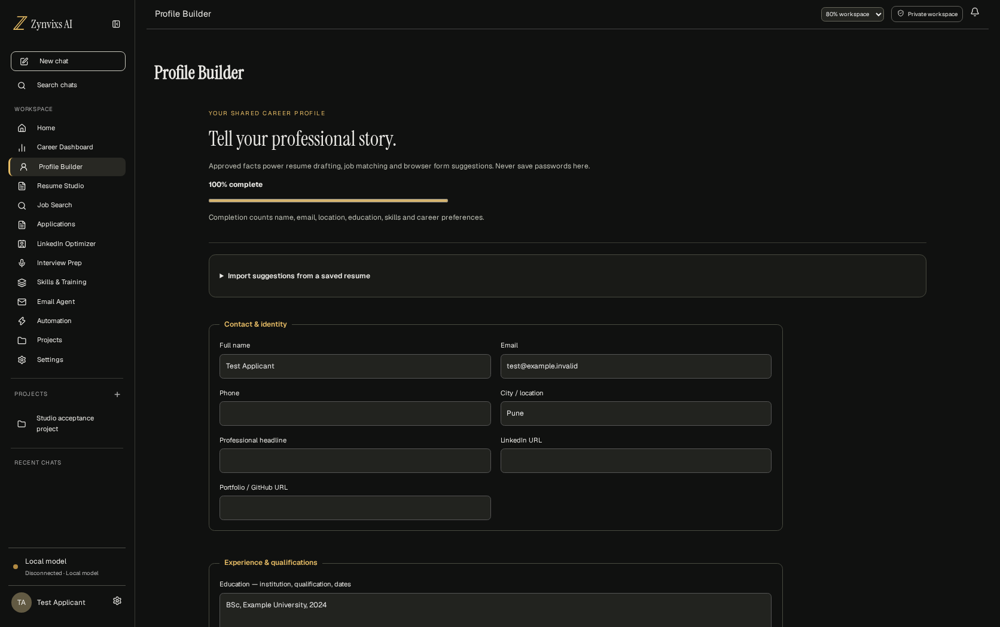 |  |

| Applications | Email Agent |
|---|---|
| 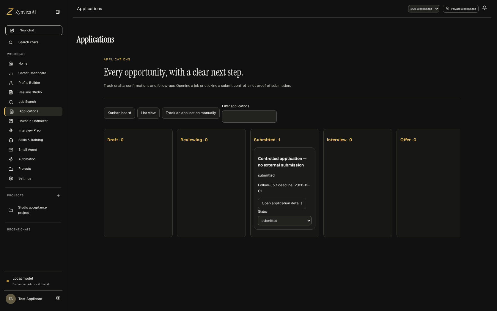 | 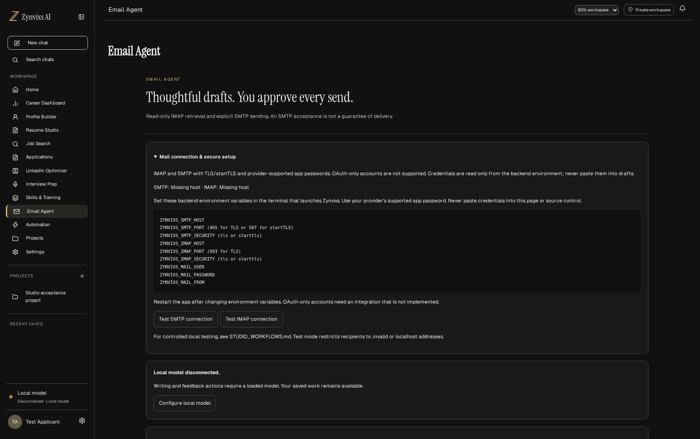 |

Light-theme and mobile samples are also saved under `docs/images/studio-light-*` and `studio-mobile-*`.

## Profile Builder → Resume → PDF download

1. Open **Profile Builder** and enter **Full name**, **Resume target role**, contact details, summary, education, experience, skills, projects and certifications. Empty optional sections are omitted.
2. Click **Save info & preview resume PDF**. This saves your profile, creates a new saved resume version, and makes it the active resume. It formats only your entered facts and requires **no model or external connection**. Career preferences, work authorization and notice period are not inserted into this resume.
3. The page moves to the real PDF preview after it finishes rendering. Use Previous/Next for multiple pages, **Open PDF full size**, or **Download resume PDF**. PDF.js and its worker are bundled locally; no CDN is contacted.
4. **Edit your information** returns to the form. Changed resume information disables download of the outdated preview until you create another version. The existing saved version is retained.
5. Reopening Profile Builder restores the latest form-generated resume. **View last saved PDF** reopens it without creating duplicates. Saved resumes remain available in Resume Studio for optional AI rewriting and further editing.

If the page cannot connect, keep the terminal running, restart **Zynvixs.bat from the updated folder**, and open http://127.0.0.1:8765 . Retry loading preserves typed values. If PDF export reports a missing dependency, run Setup.bat and retry.

Additional verification: four backend tests cover form-to-PDF conversion without model access, required-field validation, multiple saved versions, multi-page output, inline/download headers and exclusion of non-resume fields. `scripts/check_profile_resume_ui.py` uses an isolated database and tests a simulated backend outage, preserved form values, PDF service failure/retry, actual nonblank PDF.js canvas rendering, pagination, PDF download/read-back, stale-edit protection and reopen behavior in dark/light 80%/100% and mobile layouts. Run it with `.\.venv\Scripts\python.exe scripts\check_profile_resume_ui.py`.


## Resume Studio side-by-side workspace (beta.4)

Desktop uses inputs/editing on the left and a sticky saved-PDF panel on the right. Mobile stacks those panels. Select a saved resume, use profile facts, import a file or enter source information. Choose a **1–2**, **4–5** or **12-page** target before generating. The choice changes AI instructions, token budget (within the loaded model context) and PDF typography. These are targets, not guaranteed page counts: short facts are not padded; long content is never silently deleted. The preview displays the actual count. AI generation requires a loaded local model; **Preview supplied text without AI** formats exactly the supplied text. Save edits to refresh PDF output before downloading.

Verification: 114 backend tests passed, including length metadata/budgets, real PDF export without padding/truncation, insufficient context and cancelled generation. `scripts/check_resume_studio_ui.py` passed real PDF rendering/download, stale-edit protection, saved selection, missing-model state, cancellation and desktop 80%/100%, light theme, mobile and active-chat alignment. Controlled test data is used; no real model inference is claimed in this environment. Existing antivirus warning remains unresolved; this build is not antivirus-certified.

## Career discovery appearance (beta.5)

The reference-inspired blue-and-white theme applies throughout the workspace. Existing saved Light/Dark/System settings remain intact; select **Settings → appearance → Light** to use the white reference appearance. New workspaces default to Light. Home and Profile Builder include three career marketing banners: profile, resume and professional presence. Previous/next and category buttons change banners; Pause stops rotation. Rotation also pauses during hover/keyboard focus and does not start with reduced motion. Original CSS document artwork is bundled locally; no third-party advertising, image service, tracking or new credentials are involved. Marketing copy describes available workflows without promising employment results or inventing performance figures.

Checks: production TypeScript/Vite build, 114 backend tests, Profile Builder persistence and real PDF workflow, and targeted banner navigation/focus/pause/reduced-motion checks at desktop 80%/100%, dark/light and 390px mobile. All checks use an isolated temporary database and preserve user data.

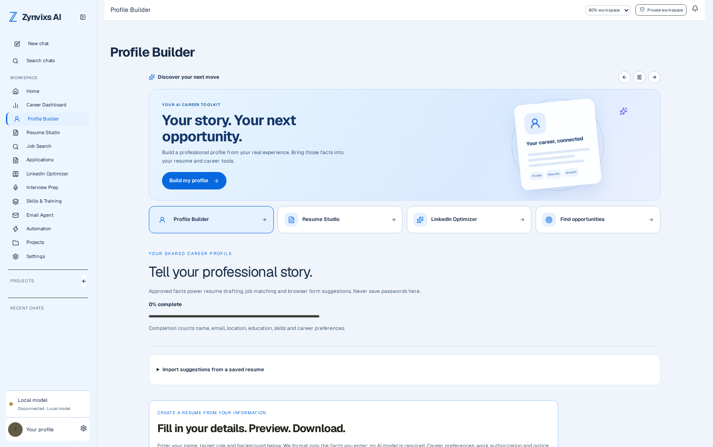


Broader regression check: `scripts/check_studio_ui.py` passed all 13 pages in light/dark at 80%/100%, mobile, profile persistence, resume import/export, LinkedIn edits, interview missing-model recovery, learning progress, application confirmation/history, project associations and email setup/review gates. No real messages or applications were sent.

## Profile discovery and White / Black appearance (beta.6)

Profile Builder now starts with a reference-inspired career discovery area: seven tool tiles and four equal-height illustrated posters for profile details, resume creation, AI profile marketing and interview practice. These navigate to real tools; profile actions focus the editable form. The existing saved profile, import suggestions and PDF workflow remain below. The artwork is original bundled CSS, not third-party advertisements or claimed job offers. On small screens the featured row scrolls with buttons or touch; arrow controls disable at the scroll boundaries. Decorative movement respects reduced motion.

Open **Settings → Appearance** and select **White**, **Black** or **System**. White uses a white main workspace with a pale-blue sidebar; Black uses near-black surfaces with accessible light text. Both retain blue accents. Choices persist in existing backend settings and affect every page plus chat and dialogs. A failed save displays an error and keeps the previous theme. The general settings dialog has the same White/Black labels. No data migration or external credentials are required.

Verified with the production build, isolated Profile Builder persistence and PDF checks, and `scripts/check_profile_discovery_ui.py`: White/Black survive reload, System follows device appearance, failed saves retain the selected theme, poster destinations work, desktop 80%/100% and mobile layouts fit, mobile carousel scrolls and reduced motion stops decorative animation.

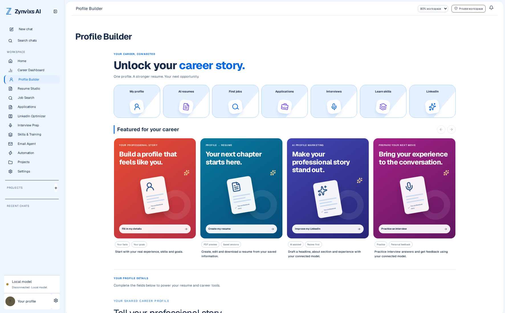

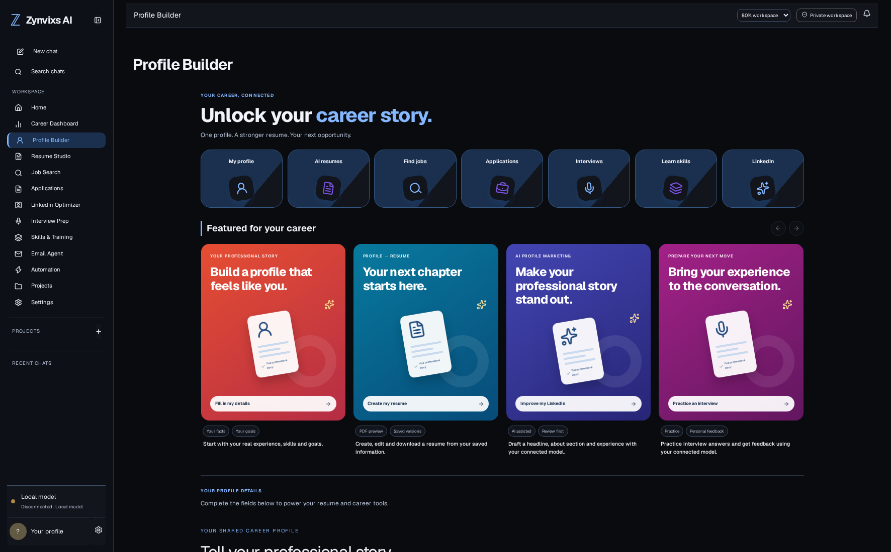

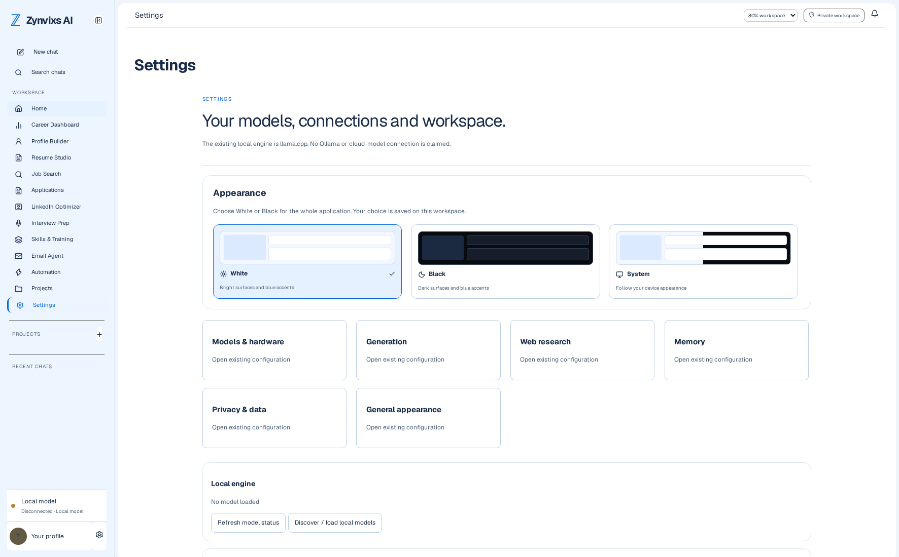

The broader `scripts/check_studio_ui.py` regression also passed all 13 pages in both appearances at 80%/100% and mobile, including resume import/export, LinkedIn edits, interview missing-model recovery, learning progress, application history, projects and email setup/review gates. `scripts/check_career_banners_ui.py` passed Home banner navigation and controls. No real messages or applications were sent.

## Recommendations, neutral text and Automation surfaces (beta.7)

Career Dashboard decorative text/icons now use normal foreground colors: black in White appearance and light in Black appearance. Legacy gold decoration was replaced with semantic colors, including focus outlines and borders. Automation's outer panel, commands, checklist text and nested cards use the active theme rather than a fixed dark surface.

Interview Prep and Skills & Training now include reference-inspired recommendation cards, Tech/Management/General filters, keyword search and View all controls. Ranking happens locally using the saved target role, skills, headline and selected resume. Each card explains keyword overlap or labels itself a general practice option; these are curated practice templates, not live opportunities or employer endorsements. Recommendations do not claim a skill gap or proficiency assessment. A profile-loading failure provides a retry and general options. Interview **Prepare practice** populates the actual target-role form for review; generating questions and feedback still requires a local model and selected resume. Learning **Add learning plan** saves an editable plan in SQLite; **View plan** reopens the existing template plan, and lesson progress survives reload. Official documentation links are external and open only when selected. Self-directed templates do not invent course providers or credentials.

Both pages end with grouped links to real existing pages, with no simulated newsletter, employer logos or unsupported subscription controls. Existing profile, resume, chat, jobs, learning records and settings remain intact.

Validation: production TypeScript/Vite build; 114 backend tests; all 13-page light/dark 80%/100% and mobile regression checks; targeted recommendation ranking/search/setup, missing-model behavior, saved learning plan/progress/reload, duplicate-plan avoidance, provider retry, footer navigation and computed dashboard/Automation colors. AI inference requires the user's configured model; no real messages or applications were sent.

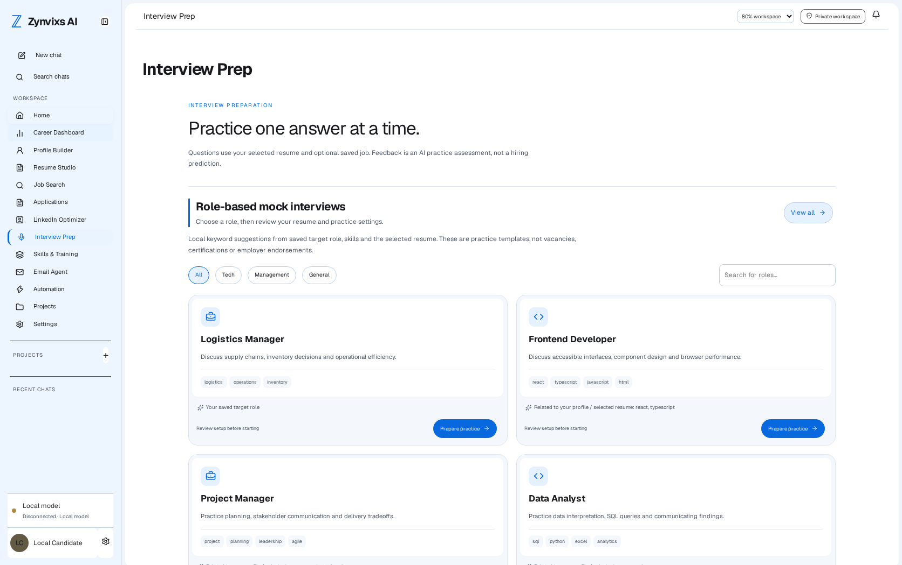

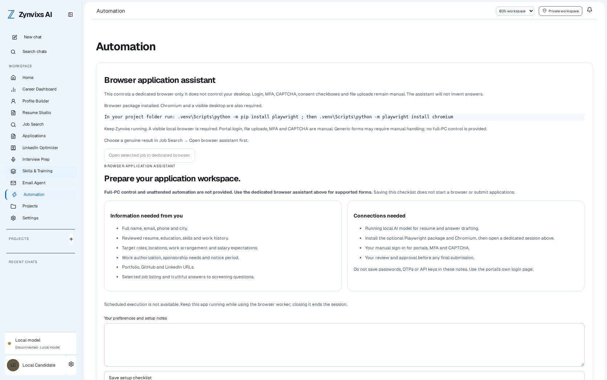

## Job Search rebuild and auto-fill (beta.8)

Job Search replaces the long form with a compact resume selector, role/location search bar, category chips, expandable filters and reference-inspired listing cards. The right sidebar contains real career shortcuts, actual provider status, employer-board setup, saved searches and clearly labeled outbound portal links. The sidebar is not a feed of invented featured vacancies. Sorting is local to displayed results; counts reflect actual retrieved or saved records. Full listing descriptions open in a keyboard-dismissible dialog. Missing salary/date/arrangement fields remain labeled as unavailable.

**Auto-fill from profile & resume** calls the local criteria API, not a model or job provider. It reads the saved target role, location and unambiguous work/job-type preferences, recognized profile/resume skills, and the first explicit years-of-experience phrase in the selected resume. Each suggested field shows its origin. Existing fields are preserved by default; **Replace filled fields on the next auto-fill** explicitly permits replacement. Unknown values remain blank, and company-board identifiers/credentials are never guessed. Review all fields before **Search jobs**; keyword and experience filters can be restrictive. Changing the active resume clears displayed matches and previously auto-filled criteria; manually edited criteria are kept for review. Saved matches from another resume are labeled accordingly.

**Application auto-fill** on a job card passes that listing to Automation's existing browser assistant. It requires the optional Playwright/Chromium worker and a visible browser. Review profile suggestions before filling, and separately approve any final submission. It does not bypass site restrictions, manual sign-in, CAPTCHA, MFA or file/consent steps. **Start Application** creates a draft record, never a submitted one. Resume tailoring, saved-job actions and cached-search restoration are retained. Cached listings are explicitly marked and should be refreshed before applying.

Validation: production TypeScript/Vite build; **117 backend tests** including new auto-fill provenance, ambiguous/unknown fields and resume-switch checks; existing 13-page light/dark 80%/100% and mobile UI regression. `scripts/check_job_search_ui.py` exercises auto-fill/no implicit retrieval, edit preservation/explicit replacement, provider failures, listing details, real saved/draft/cache endpoints, tailoring/browser handoff and resume invalidation with clearly labeled provider fixtures in an isolated subprocess. No test vacancies are shipped as product data and no real applications are submitted. A separate read-only live Remotive check returned **17 genuine listings** on 17 November 2026; availability can change. Browser handoff was checked, not a new live external-site application submission.

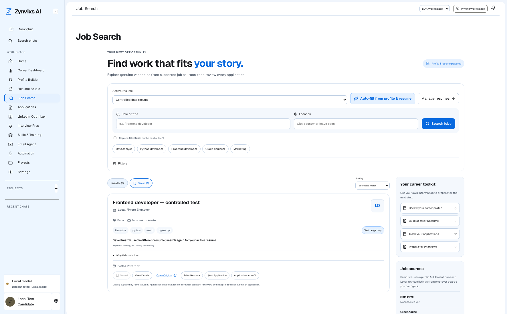

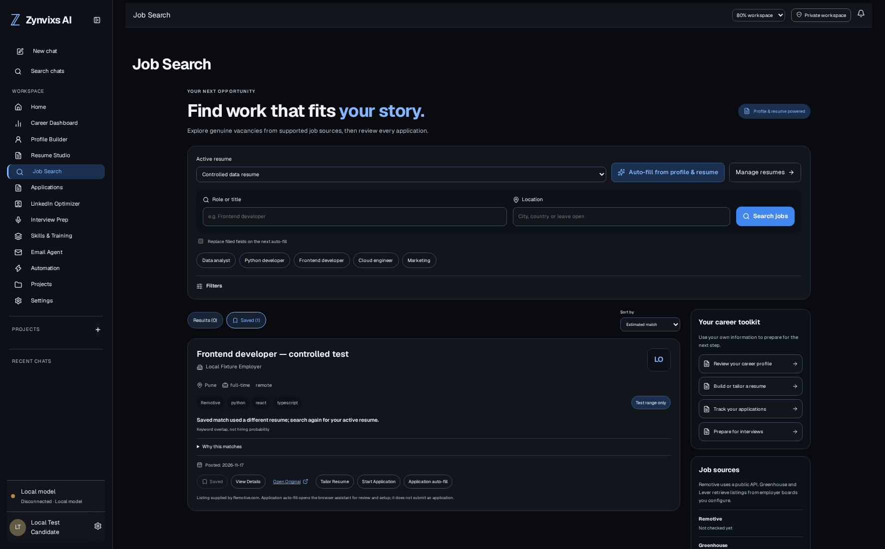

## Compact Job Search directory (beta.9)

Job Search now follows the supplied listing-directory reference more closely: a centered heading with actual result/saved counts, horizontal category chips, a slim resume/auto-fill row, compact role/location search and filter pills, slimmer listing cards and a narrow featured-career-tools sidebar. The sidebar opens real existing career pages; it does not copy third-party advertisements or invent offers. A redundant large page heading is visually hidden while retaining the accessible page heading.

Use the bookmark icon to **Save Job**. Select the **three-dot menu** for **Tailor Resume**, **Start Application** and **Application auto-fill**. Original links and full details remain visible, with match explanations in the expandable **Why this matches** section. Type/Location/Roles shortcut pills open or focus their actual filter controls. Existing profile/resume auto-fill, provider setup/status, cached history, sorting and saved-job views are retained. No user data or retrieval logic is replaced.

Checks: production build, 117 backend tests and all 13-page appearance/scale/mobile regressions passed. The isolated Job Search UI script checks criteria auto-fill/edit preservation, actual backend save/draft/cache flows using labeled provider fixtures, failed providers, details dialogs, the action menu, tailoring/browser handoff, resume invalidation, filter shortcut focus and White/Black 80%/100% plus mobile layouts. No real applications or messages are sent by these checks. No additional configuration is introduced; live sources and browser-worker limitations from beta.8 still apply.

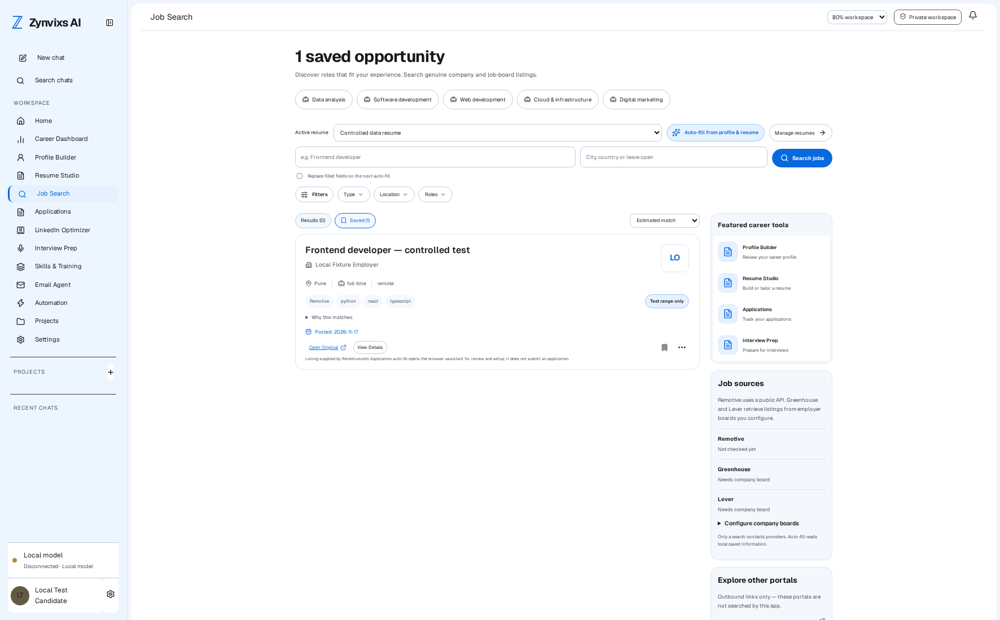

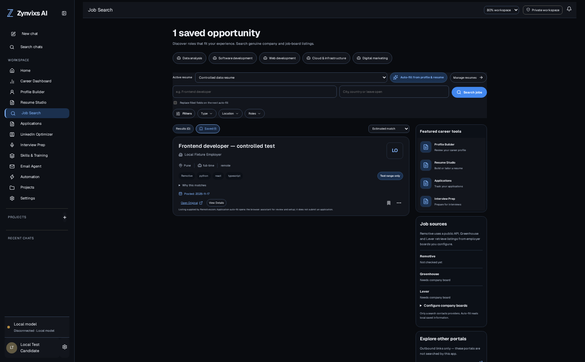

## Job Search banners (beta.10)

The results column now includes a **Career spotlight** area with two illustrated posters (Resume Studio and Interview Prep) and a wide Skills & Training banner. These remain visible below the empty/saved-results area so a short results column no longer ends in a large blank block alongside the taller source sidebar. The sidebar **Featured** area has five thumbnail-style career promotions for resume, profile, interview, learning and application tools, each with a working destination. They are clearly separate from vacancy listings; no third-party events, sponsors, offer counts or jobs are invented.

All new artwork is original inline SVG/CSS, bundled locally. No image CDN, tracking service, new credentials or dependencies are introduced. Gentle animation honors reduced motion. Existing search, auto-fill, provider setup, saved jobs, application drafts, tailoring and browser handoff remain unchanged.

Checks: production TypeScript/Vite build; 117 backend tests; isolated Job Search UI checks covering banner/featured destinations, reduced motion, White/Black at 80%/100%, mobile fit, and the existing auto-fill/save/draft/cache/detail/tailoring/browser flows using labeled provider fixtures. No real applications were submitted. Resume/AI interview generation still needs the configured model, and browser application filling still needs the optional browser worker and review.

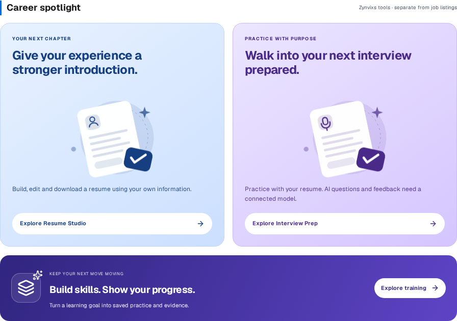

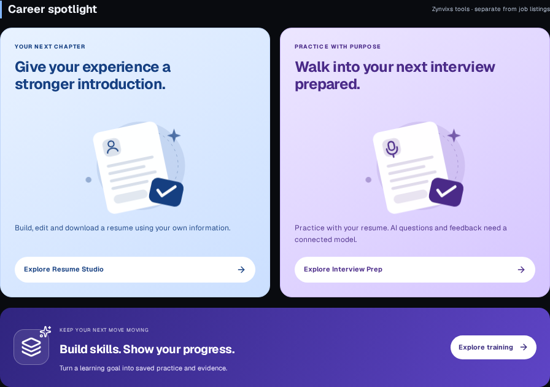

## Filling the Job Search results gap (beta.11)

A full-width blue profile banner now sits at the top of the existing Career spotlight group, with real Profile Builder and LinkedIn Optimizer actions. For an empty or single-result list, the group follows the empty state or card immediately, rather than leaving a large white area alongside the sidebar. Longer lists show the group after the second vacancy instead of burying it after all results. The existing resume/interview illustrated posters and training strip remain below the new banner. Promotional content stays clearly labeled and separate from actual vacancies.

Verification: production TypeScript/Vite build and isolated Job Search UI checks. The script measures the empty-state-to-banner gap (under 45 screen pixels), exercises profile/LinkedIn and other banner destinations, and checks White/Black at 80%/100%, mobile overflow and reduced motion alongside existing save/draft/cache/search flows. No real applications are submitted; no backend data schema, external connections or setup requirements change. Restart from the newly extracted beta.11 folder to load the updated bundled interface while preserving your existing data/models.

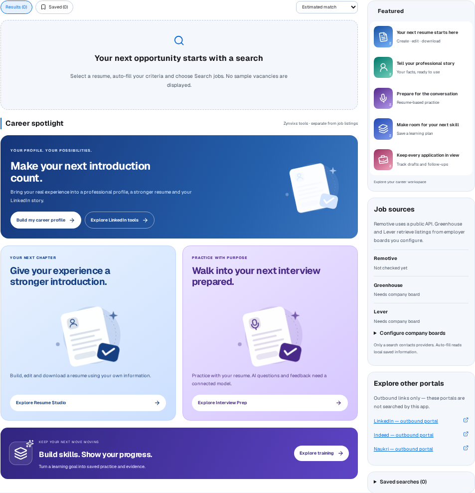

## Applications command center (beta.12)

Applications now has five working career banners: review unfinished applications, Resume Studio, Interview Prep, application reminders and activity. Summary tiles calculate actual tracked, awaiting-response, interview and offer counts from saved application records. Their buttons filter the real records. Kanban/list views support text, status and application/creation-date filters. The seven board columns are Saved, Preparing, Applied, Interview, Offer, Rejected and Withdrawn; Preparing groups existing `draft` and `reviewing` values while preserving their labels/history. A dropdown provides keyboard access alongside drag/drop. Opening a card, original listing or browser never marks it Applied. Moving to Applied requires explicit confirmation of the employer receipt. No new database table migration is needed and legacy records/custom metadata remain intact.

The details drawer saves company, role, location, next action, recruiter contact, application/interview/deadline/follow-up dates, notes and cover letter text. The original resume ID is retained until you explicitly choose a different version; its PDF export uses that saved version. Cover letter text can be downloaded. Typed edits are retained after failed saves, and closing a dirty drawer asks before discarding changes. Historical missing dates are shown as unknown rather than invented. Counts use stages rather than guesses about employer responses.

Application reminders are saved in the existing tasks collection and are shared with Career Dashboard. Follow-up, interview and deadline tasks use the selected date field, save details first and reuse an existing application/kind/date reminder. Creation is serialized under the existing SQLite lock to prevent duplicates. Completion/reopening persists real events in the task metadata, including when updated from other existing task controls. Activity lists actual status and reminder-completion events; old records without history are not backfilled with invented dates. Reminders are in-app records; no background emails or OS scheduling is claimed.

The reviewed-assistant section reads local saved profile, linked resume, cached listing and tasks. Supported cached jobs can open the existing browser worker; manually tracked opportunities without cached job context show a clear setup path through Job Search. Saved changes are required before leaving for profile review, tailoring, interview prep or browser assistance. Tailoring selects the linked resume and passes the genuine listing description when available. Interview prep selects the linked resume and target role. Generation/feedback requires a loaded model. Browser automation still requires optional Playwright/Chromium and a visible browser, with manual site sign-in/MFA/CAPTCHA/uploads and separate final-submission approval. No passwords or provider credentials are added to application notes or frontend code.

Verification: production TypeScript/Vite build; **120 backend tests**, including Saved-stage preservation, local context without status mutation, metadata/version persistence, parallel duplicate-reminder prevention, durable task-completion history, invalid dates and unconfirmed-submission rejection. The isolated application UI script checks cover-letter download, details persistence, confirmation acceptance/rejection, reminder creation/completion/reload, history, search/date filters, failed-save edit retention, banners, linked interview/browser handoffs and White/Black 80%/100% plus mobile drawer fit using controlled provider fixtures. The existing 13-page regression script also passed. No real recipients were contacted or applications submitted; real model inference and live external application submission were not performed.

Startup remains: extract the updated ZIP, retain your `data` and `models` folders, and run `Zynvixs.bat` from that folder. Use `Setup.bat` if dependencies are not installed. No additional credentials are needed for tracking, banners, manual details or local reminders.

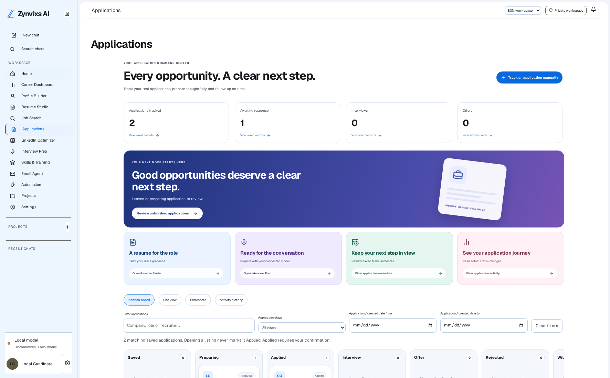

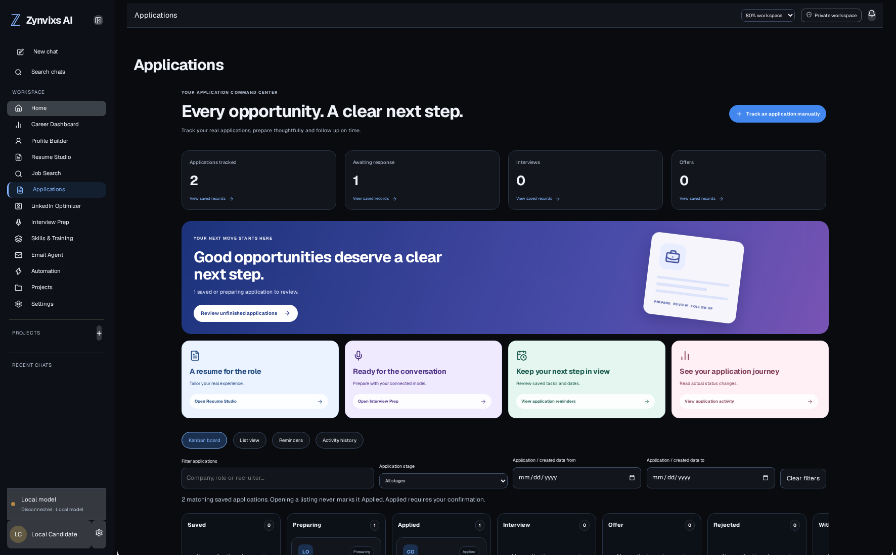

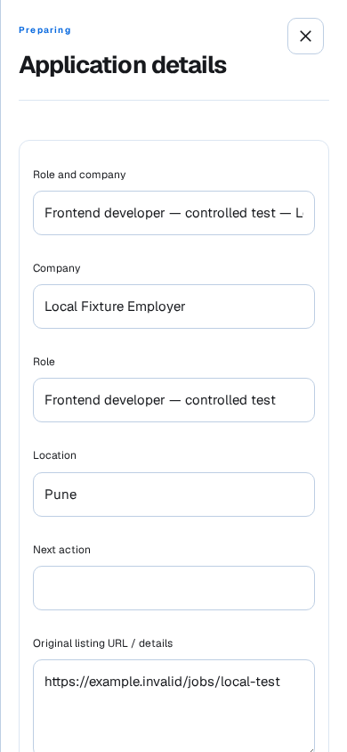

## LinkedIn profile → resume → reviewed application (beta.13)

LinkedIn Optimizer now includes five career banners and an editable shared-profile intake for contact details, career target, headline, summary, education, experience, skills, projects and certifications. **Save details & use in LinkedIn draft** explicitly saves to the same profile storage as Profile Builder and imports approved text into the source editor. **Use saved profile in LinkedIn draft** reads the saved profile without overwriting currently typed intake fields. Existing filled source sections are kept unless **Replace filled LinkedIn source sections…** is selected. Contact email/phone are excluded from the assembled public About text. Source imports respect the existing editor length limits; full saved profile/resume records are not truncated or deleted. Existing uploaded profile exports and old workspace drafts remain available.

**Save details & preview resume PDF** uses supplied profile facts without requiring a model, creates a new saved version, selects it as the shared active resume, and renders actual PDF bytes locally. Download is disabled when the intake changes until a new PDF is saved. The active form-generated resume can be restored when reopening the tab. Saved resumes can also be selected and imported as source text without rewriting the shared profile.

AI suggestions still require the configured local model. **Save source as editable draft** works without inference and is labeled manual; AI/manual versions remain distinguishable. Headline/About/Experience are editable side by side with their original text, with per-section copying, editable suggested skills, text export and new-version saves retaining parent IDs. No new model or remote publishing integration is claimed.

The saved-opportunity step uses actual saved vacancies. **Prepare selected application** creates/reopens a draft in Applications; the selected resume is linked only for editable Saved/Preparing/Reviewing records. Already-submitted records keep their used resume. **Review browser auto-fill** passes the supported cached job to the existing Automation workflow. Missing cache errors point back to Job Search. The app does not publish a profile to LinkedIn or auto-submit applications. The publishing panel clearly explains manual copy/update and provides a user-initiated outbound LinkedIn profile link. Browser assistance requires existing Playwright/Chromium setup and review, plus manual site login, uploads, consent, CAPTCHA/MFA as needed. No passwords or API credentials are collected in the profile form.

Validation: production TypeScript/Vite build, 120 backend tests and the existing 13-page regression checks. `scripts/check_linkedin_journey_ui.py` uses isolated data and local provider fixtures to check failed-profile-save retention, source preservation/replacement, missing-model state, manual/version drafts, copy controls, actual PDF download/readback and stale protection, shared-profile reload, application preparation with the selected resume, duplicate avoidance and browser handoff, White/Black 80%/100%, mobile fit and reduced motion. No live LinkedIn publishing, real model inference or real application submission was performed. Existing data and setup instructions are preserved; no new credentials or runtime dependencies are required for local features.

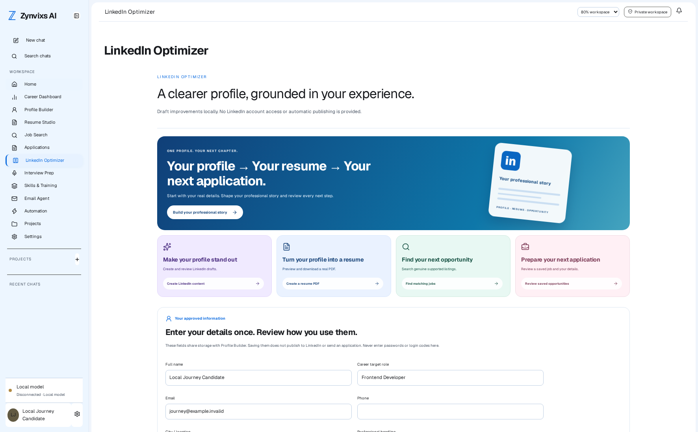

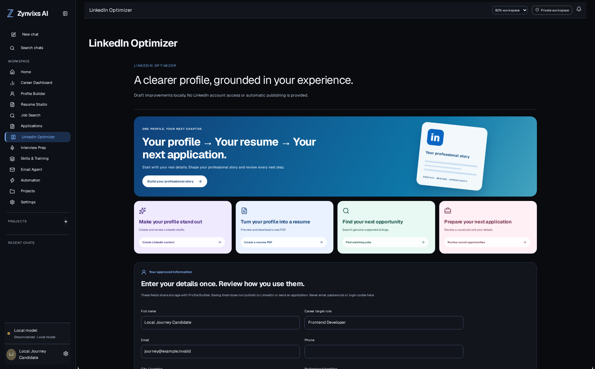

## Email Agent workspace (beta.14)

Email Agent now has five career banners: recruiter introduction, application follow-up, interview thank-you, resume selection and follow-up tasks. They open working drafting, attachment and reminder controls. Inbox/Drafts/Sent/Follow-ups tabs use existing persistent collections, with a message list and plain-text reader/composer, text search, application-link filtering and send-outcome filtering. Summary counts represent cached messages, actual saved email drafts, SMTP-accepted attempts and incomplete local email tasks. Unknown/loading counts show a dash. No external inbox is contacted on page open; **Retrieve real inbox messages** is explicit, read-only IMAP and caches the latest 20 fetched messages. Local application links survive later retrieval. Remote email images/HTML are not executed or fetched.

Drafting supports manual text without mail credentials and model-assisted recruiter introductions, application messages, follow-ups, thank-you notes and interview replies using approved profile, selected application/resume and optional cached reply context. The AI does not infer a recipient or send. Selected application details can fill an empty recruiter address/resume only after you choose that action. Drafts, source-mail/application links and exact saved resume IDs persist; older unclassified drafts remain reviewable. One recipient address is supported per message.

Resume attachments can be PDF or DOCX from an exact saved version. The final review includes sender, recipient, subject, body, filename, byte count and SHA-256. Reviewed bytes are snapshotted in the existing SQLite database; the SMTP MIME attachment uses those exact bytes. Changes to the draft, resume content/version or format require fresh review. The server enforces approval/hash matching and blocks duplicate attempts, retaining the legacy digest for messages without attachments so previous attempt records still protect against repeats. Accepted/failed histories retain the actual message/application/resume snapshot and attachment reference even after the draft changes. **Accepted by SMTP is not proof of delivery.** Failed/unknown attempts must be checked with the provider before considering another message; no automatic retry is performed. Sending never marks an application submitted.

Follow-ups from a draft or cached message create date-validated, duplicate-safe tasks shared with Career Dashboard. Completion is saved and can be reopened from the Follow-ups tab. They are local reminders, not scheduled outbound emails or guaranteed OS/background notifications. Keep the app open to view them. No new credentials or runtime dependencies are required for offline composition, saved reminders or attachment preview.

Mail access still requires configured IMAP/SMTP TLS or startTLS, provider-supported app passwords and a sender address through the existing `ZYNVIXS_*` backend environment variables shown in secure setup. The page never requests or stores passwords in profile fields/drafts/frontend code. Configuration does not claim connectivity until an explicit test succeeds. OAuth-only providers are unsupported and require a future authorized integration. The local model is separately required for AI wording; real model inference was not performed in this environment.

Validation: production TypeScript/Vite build; **124 backend tests**, including legacy duplicate-hash compatibility, actual PDF/DOCX MIME bytes, resume-mutation rejection after review, immutable attachment history across DB restart, local mailbox association preservation and date/dedup checks. The existing 13-page regression passed, including missing mail credentials and review gating. `scripts/check_email_workspace_ui.py` runs isolated SQLite with loopback-only SMTP/IMAP fixtures, tests connection/inbox, disconnected-model state, draft save/review/edit invalidation, one explicit `.invalid` fixture send, duplicate rejection, exact attachment bytes, application links, persistent follow-ups and White/Black 80%/100% plus mobile composing. No real recipients are contacted, no real provider inbox is read and no real applications are submitted.

Startup: retain `data`/`models`, extract the update and run `Zynvixs.bat` from the new folder. Configure the documented backend mail environment variables and restart to enable real inbox/sending; use `Setup.bat` only if dependencies are missing. Existing data and settings are retained.

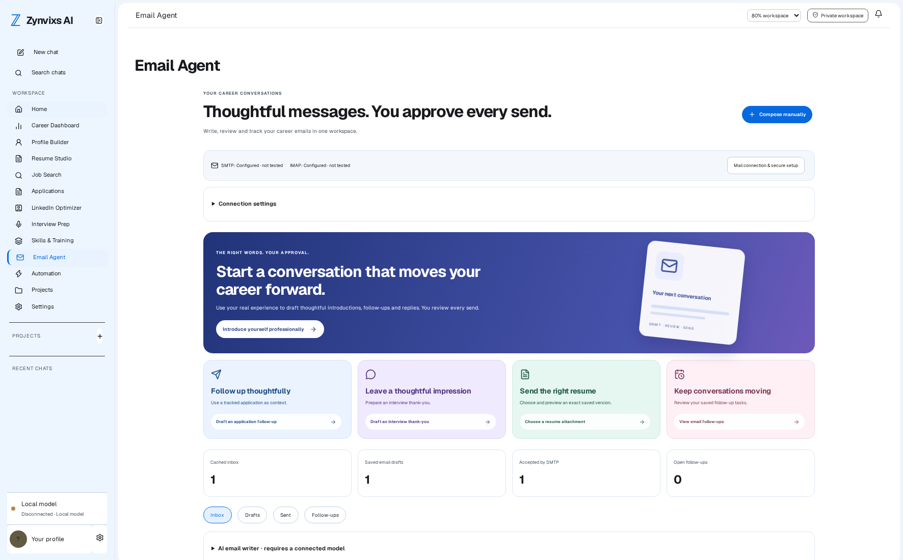

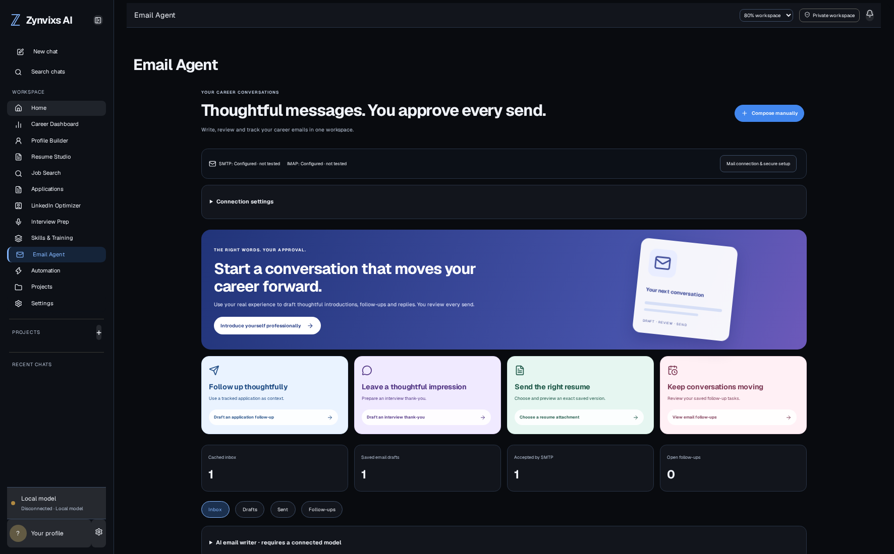

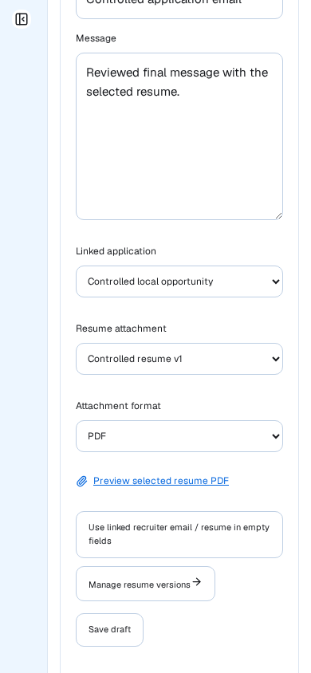

## Automation browser guide and portal banners (beta.15)

Automation now opens with a browser-control hero banner and four career shortcut banners for Profile Builder, Resume Studio, Job Search and Applications. **Open browser workspace** scrolls/focuses the actual existing browser controls; it does not start a session or submit a form. A four-step guide covers choosing a retrieved job, opening/signing in manually, reading/preparing supported fields, and reviewing/filling before explicit submission approval. Existing setup commands, checklist saving and browser-session controls remain available below.

LinkedIn, Naukri, Indeed and Glassdoor cards open real portal URLs in a separate tab only when selected. They are labeled **Outbound portal link · manual exploration**, not live feeds or verified application integrations. Generic browser filling is available only for compatible forms reached from a supported cached vacancy, and site redirects/different domains can require manual handling. The guide separately lists actual Remotive/Greenhouse/Lever retrieval support and links to Job Search source configuration. It does not promise LinkedIn Easy Apply, Naukri auto-apply, full-PC control, scheduled/unattended applications or guaranteed portal compatibility.

Login, credentials, consent, uploads, CAPTCHA and MFA stay with the user. Unknown screening answers are not invented. An apparent submit click does not prove receipt; track Applied only after verifying employer confirmation. Keep Zynvixs and the visible browser running while working. Optional Playwright/Chromium, a visible desktop and a supported selected job are still required; no new credentials, external requests on page load or dependencies are introduced.

Validation: production TypeScript/Vite build; 124 backend tests; existing 13-page light/dark 80%/100% and mobile regression; `scripts/check_automation_guide_ui.py` verifies browser-workspace focus, the missing-job gate, banner destinations, outbound portal URLs/labels, full-PC limitation, mobile overflow and reduced motion. No external portals were visited and no applications submitted for these guide checks. Live external portal compatibility was not newly validated.

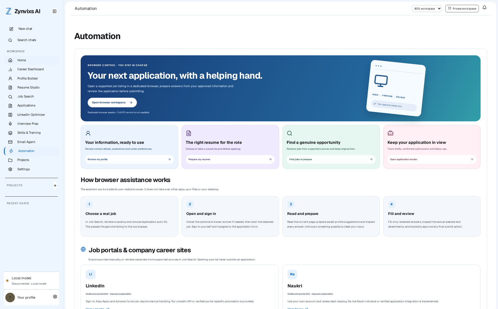

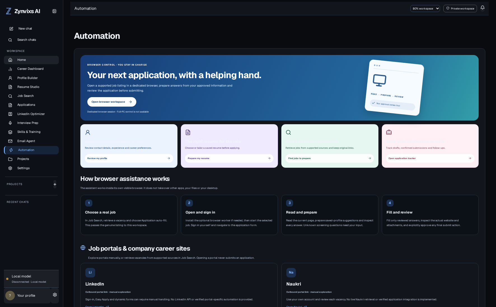


## Chat and Settings control alignment (beta.16)

Fixed-size icon buttons now use zero padding and centered flex alignment. Attachment, send/stop, file removal and Settings close retain their original actions. Send uses the selected theme's primary color; Settings switches retain their saved state without inherited text-button borders/padding.

Validation: production TypeScript/Vite build and targeted Playwright checks for White/Black at 80%/100%, mobile overflow, centered icons, actual file chooser/upload/removal, persisted Settings switch and modal close. Click/Enter dispatch and Shift+Enter newline were checked with controlled request capture; no model inference, external mail or real applications were performed. Screenshot regression artifacts were captured across all 13 pages. No backend behavior changed or new connection configuration is needed.

Extract the updated ZIP, preserve existing `data` and `models` folders, and restart `Zynvixs.bat`. Existing installation requirements remain unchanged. Antivirus verification is not implied by these UI checks.

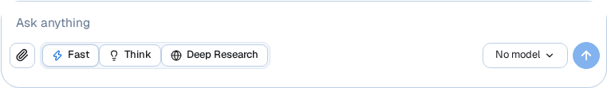

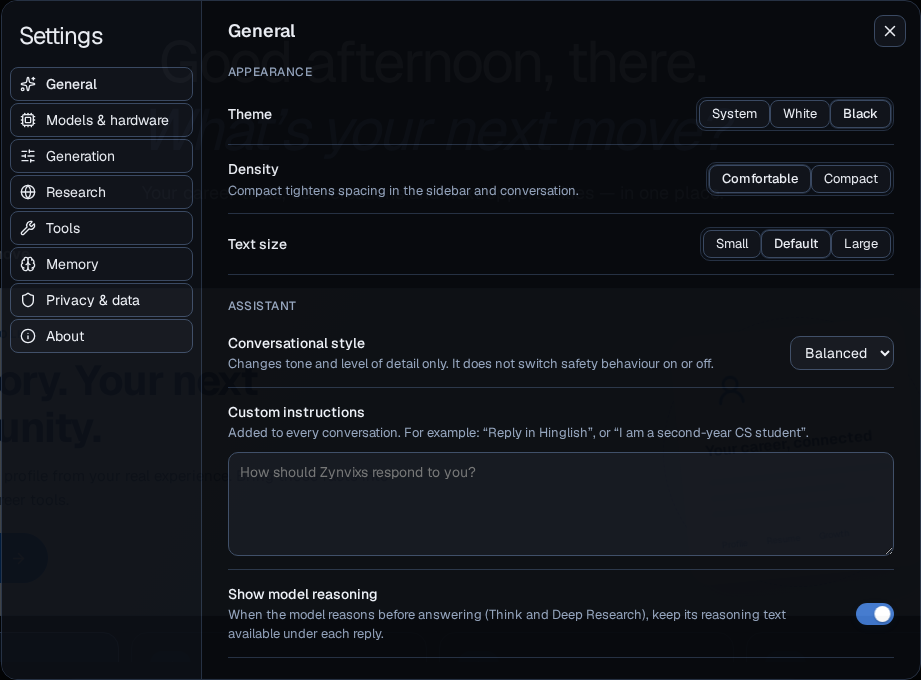

## Paginated Resume Studio (beta.17)

The desktop editor and saved-PDF output remain side by side. Mobile offers Editor/Preview buttons to avoid an excessively long stacked form. Review every real PDF page through thumbnail buttons, Previous/Next or the page selector; choose Fit to width or 75/100/125/150% preview zoom. The PDF download uses the exact already-previewed blob. DOCX remains available as an editable Word document; its pagination can differ between Word applications.

Choose 1–2, 4–5, up to 12 pages or a custom 1–30 page target, plus A4 or US Letter. Layout changes require saving a new version and disable the old PDF download until saved. Actual count is displayed with an explanation when it differs from the target. No artificial facts, duplicated content or blank pages are added; long supplied content is retained even if it exceeds the target. Model context/output limits are recorded and surfaced when reported. Page targets cannot guarantee document length or a complete live model response. Longer source input is supported, with an actionable model-context error when it cannot fit. Generation cancellation and earlier saved versions remain available.

Validation: production TypeScript/Vite build; 125 backend tests; `check_resume_studio_ui.py` (editing/version refresh, PDF, presets, disconnected model, cancellation and layouts); `check_resume_pagination_ui.py` (17-page supplied-text fixture, page 12/last/previous, thumbnails, zoom/fit, exact preview-download bytes, A4/Letter, custom version persistence, DOCX, mobile and White/Black 80/100%). Tests used temporary data and controlled model streams where required. No live model inference or RTX hardware performance was verified. Existing saved data is retained; no new runtime dependencies or credentials are required.

Startup: extract the updated ZIP into your chosen app installation, preserve `data` and `models`, and restart `Zynvixs.bat`. Run `Setup.bat` if dependencies are missing. AI drafting requires an installed, loaded model; supplied-text editing, PDF preview and export work without one.

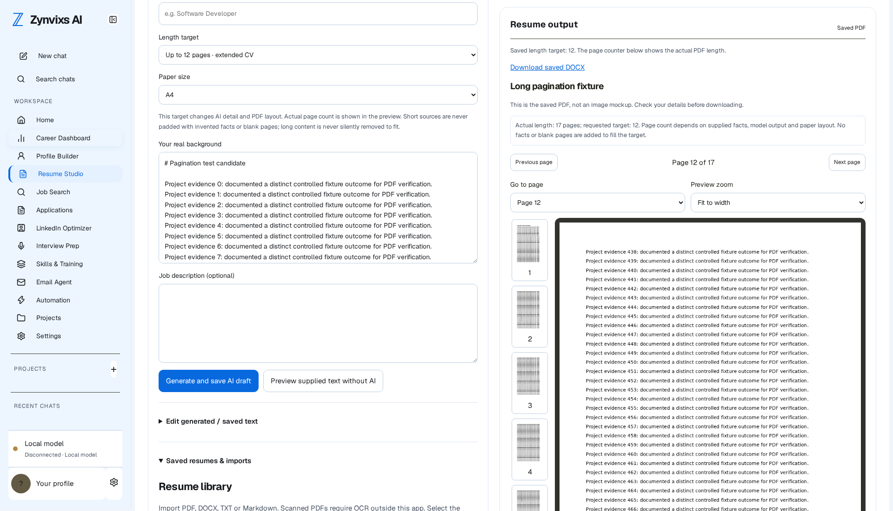

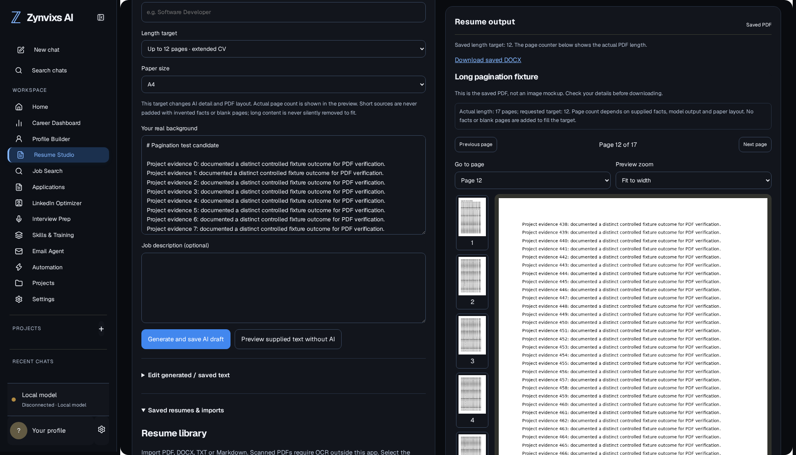
