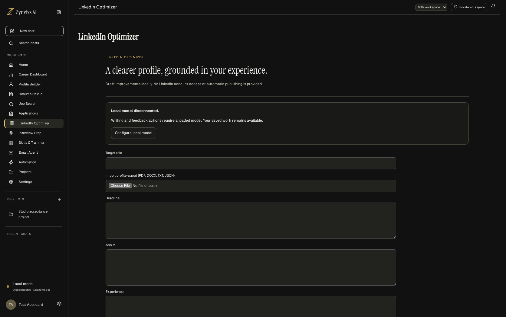
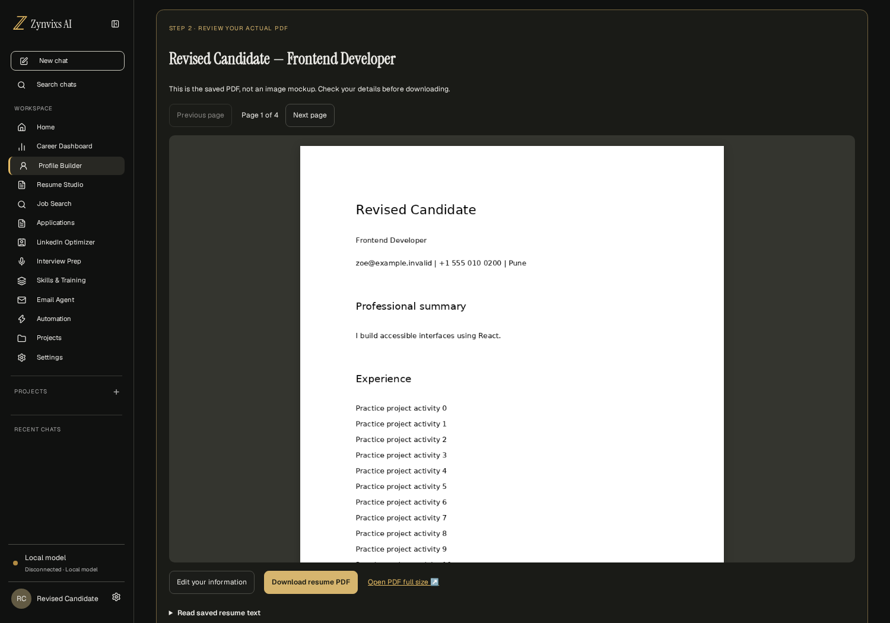
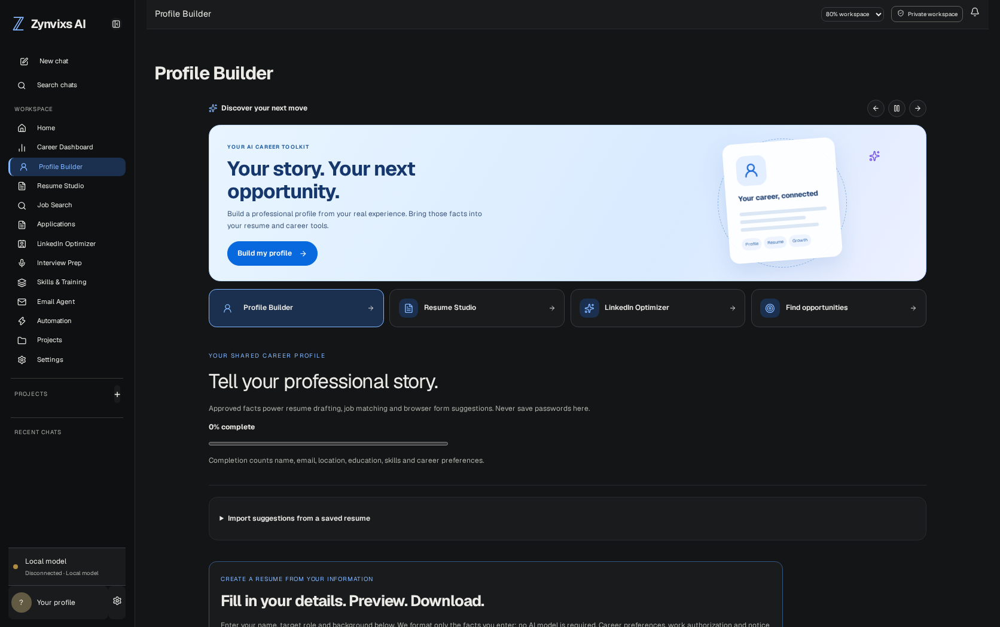

# Zynvixs career studio — setup, workflows and verification

## Start or update on Windows

1. Back up your existing `data` folder. Keep your `models` folder. The update adds tables and JSON fields; it does not replace chat, document, project or settings tables.
2. Download the current **[application ZIP](https://github.com/atharvposam-ctrl/zynvixs-ai/raw/refs/heads/main/zynvixs-main.zip)** and extract into a separate folder. Copy your existing `data` and `models` folders if moving the installation, retaining the originals. You can instead set `ZYNVIXS_DATA` / `ZYNVIXS_MODELS` to their existing paths.
3. Install Python 3.12 with **Add Python to PATH** checked. Run `Setup.bat`, then `Zynvixs.bat`. The app opens at http://127.0.0.1:8765 . Setup contacts package repositories and the llama.cpp release server to install dependencies/runtime.
4. The application ZIP includes the built frontend. A source checkout requires Node.js 22+ and `cd frontend; npm ci; npm run build`, or let Setup build it.
5. Open **Settings → Models & hardware**, download/load a compatible model, then use AI writing/feedback. The supported engine is llama.cpp; no Ollama or cloud-model integration is claimed.
6. App workspace scale defaults to 80%; choose 100% in the top bar. This does not alter browser zoom. Light/dark/system, density and text-size preferences use the existing settings backend.

## Implemented pages

| Page | Workflow |
|---|---|
| Home / Chat | Existing streamed chat, documents, Fast/Think/Research, cancellation, model controls, saved conversations, search and keyboard shortcuts. |
| Career Dashboard | Counts from saved work, career tool navigation and persistent tasks. Reminders appear inside the running app; no background OS notifications are claimed. |
| Profile Builder | Named contact, education, experience, skills, projects, certifications and preference fields. Resume extraction produces suggestions for review, never an automatic overwrite. Completion uses six listed saved fields. Old custom notes remain accessible. |
| Resume Studio | PDF/DOCX/TXT/Markdown import, shared active resume, profile-based AI drafts, job tailoring, whole-document or heading-based section editing, preview, version copies, and PDF/DOCX/Markdown export. Save before exporting a changed version. |
| Job Search | Genuine public API retrieval from Remotive, configured Greenhouse boards and Lever employers; reviewed criteria, filters, estimated skill matches, deduplication with original links, descriptions, saved jobs and saved search criteria/cache. Cached searches are labeled and should be refreshed before applying. |
| Applications | Kanban/list views, manual or job-linked drafts, resume-version association, notes, deadlines, dashboard reminder tasks and server-kept status history. Submitted requires your explicit assertion that you verified the employer confirmation. |
| LinkedIn Optimizer | Paste sections or import text-based PDF/DOCX/TXT/JSON exports; target-role AI suggestions; original/proposed comparison, explanations, keywords, editable saved versions, copy and text export. No account access or automated publishing. |
| Interview Prep | Resume/job-based questions, one answer at a time, saved AI feedback and suggested revisions, resumable sessions and final strengths/practice summary. AI assessments are practice feedback, not employer judgments. |
| Skills & Training | Listing/resume/profile skill-gap comparison, curated official resource links, editable practice activities, manual goals, evidence notes and self-reported lesson completion. Progress is completed lessons divided by total lessons, not a certification. |
| Email Agent | Environment-held IMAP/SMTP credentials; real connection tests; read-only latest-message retrieval and local cache; AI/manual drafts, saved-draft review and explicit send approval; SMTP outcome history and duplicate-attempt blocking. |
| Automation | Optional dedicated-browser worker, reviewed profile-field suggestions, user-approved text filling, form inspection, cancellation and explicitly approved submission attempts. No full-PC control or unattended schedule. |
| Projects | Existing project creation/rename, archive/restore, associations with chats, documents, resumes, jobs, searches, applications, tasks, interviews, learning and other career work. Project chats retain the original attachment workflow. |
| Settings | Existing model/generation/research/memory/privacy controls, working appearance preferences, connection setup navigation, live backend refresh and full workspace JSON export. Credentials are not included in exports. |

### Data and AI boundaries

All records are local SQLite data. Named profile sections use the latest saved value; older records are retained for export/history rather than silently deleted. The selected resume persists across restarts. AI requests use the loaded local model and do not send resume/profile text to a cloud AI service. Long source content is bounded for model context. Models can still make mistakes: review every qualification, date, claim and suggested answer. Structured-output failures, missing models and busy/time-out states produce actionable errors rather than substitute content.

Scanned PDFs need external OCR; encrypted/malformed documents are rejected. PDF export uses an available system font; verify rendering for scripts not covered by that font. DOCX/PDF exports use headings and list formatting rather than embedding Markdown markers.

### Genuine job sources

- Remotive public API: retrieved when you run a search, attributed with original links.
- Greenhouse: provide a real board slug, for example `stripe`.
- Lever: provide a real employer slug, for example `palantir`.
- LinkedIn, Indeed and Naukri: **outbound links only**; no result retrieval from those sites is claimed.

Only search role/keyword text and board identifiers go to the providers; matching against resume/profile happens locally. Filters operate on available provider fields. Unknown arrangement, salary, dates or experience are not invented. Greenhouse updated dates are labeled accordingly. Compatibility is recognized skill overlap with a stated heuristic, not a hiring probability. Search results are capped at 150. Source availability and terms are external requirements.

## Real IMAP / SMTP setup

Supported: standard IMAP and SMTP with TLS/startTLS and provider-supported app-password authentication. OAuth-only accounts require an OAuth integration that is **not implemented**. Gmail/other providers may require enabling IMAP and generating an app password; use the provider's actual documentation and account policy.

Set these backend process environment variables in the same PowerShell session that launches the app. Do not place real passwords in source files, screenshots, profile fields or drafts.

```powershell
$env:ZYNVIXS_SMTP_HOST = "your-provider-smtp-host"
$env:ZYNVIXS_SMTP_PORT = "465"
$env:ZYNVIXS_SMTP_SECURITY = "tls" # or starttls with the provider's port
$env:ZYNVIXS_IMAP_HOST = "your-provider-imap-host"
$env:ZYNVIXS_IMAP_PORT = "993"
$env:ZYNVIXS_IMAP_SECURITY = "tls"
$env:ZYNVIXS_MAIL_USER = "your-email-address"
$secret = Read-Host "Provider app password" -AsSecureString
$env:ZYNVIXS_MAIL_PASSWORD = [System.Net.NetworkCredential]::new("", $secret).Password
$env:ZYNVIXS_MAIL_FROM = "your-email-address"
.\Zynvixs.bat
```

Use **Email Agent → Test SMTP / Test IMAP**. Those actions test the real connection without sending a message. Inbox retrieval uses a read-only mailbox and BODY.PEEK. Email HTML is not rendered or allowed to load remote tracking images. Drafting never infers the recipient address. Sending requires a fresh review hash and explicit approval; changed drafts invalidate approval. Each exact draft version gets at most one send attempt. A timeout may mean an uncertain outcome: check the provider before creating another draft. `accepted_by_smtp` means server acceptance, **not proof of recipient delivery**. Attachments are not supported by the email composer; use your mail client for attachments.

### Controlled local mail testing — no real recipients

Terminal 1, from the project root:

```powershell
cd backend
..\.venv\Scripts\python.exe -m zynvixs.mail_test_server
```

This explicitly starts loopback-only SMTP on 1025 and IMAP on 1143. It serves a labeled fixture inbox and keeps received test messages in memory; it never relays anything to the Internet.

Terminal 2, from the project root:

```powershell
$env:ZYNVIXS_MAIL_TEST = "1"
$env:ZYNVIXS_SMTP_HOST = "127.0.0.1"
$env:ZYNVIXS_SMTP_PORT = "1025"
$env:ZYNVIXS_SMTP_SECURITY = "plain"
$env:ZYNVIXS_IMAP_HOST = "127.0.0.1"
$env:ZYNVIXS_IMAP_PORT = "1143"
$env:ZYNVIXS_IMAP_SECURITY = "plain"
$env:ZYNVIXS_MAIL_USER = ""
$env:ZYNVIXS_MAIL_PASSWORD = ""
$env:ZYNVIXS_MAIL_FROM = "sender@example.invalid"
.\Zynvixs.bat
```

Test both connections, retrieve the fixture inbox and send a manually reviewed draft to `recipient@example.invalid`. Test mode accepts only loopback servers and `.invalid`/localhost recipients. Stop the fixture server with Ctrl+C. Remove `ZYNVIXS_MAIL_TEST` and configure real TLS endpoints before using a real account. Never disable security warnings to run the app.

## Optional browser worker

```powershell
.\.venv\Scripts\python.exe -m pip install -r backend\requirements-browser.txt
.\.venv\Scripts\python.exe -m playwright install chromium
```

Choose a retrieved job → Open browser assistant. The worker opens a dedicated, nonpersistent Chromium session on this PC. Keep Zynvixs running with a visible desktop. Navigate to the form manually, read fields, prepare suggestions from exact saved profile fields and review the proposed answers before filling. Unknown screening questions require your truthful answers; the worker never guesses them. Passwords, consent controls, file uploads, login, MFA and CAPTCHA remain manual.

Review the entire actual form, attachments and consent before explicitly approving submission. The worker only attempts a unique same-site submit control; changed forms invalidate review. Cross-site transitions, ambiguous controls and complex portal forms require manual handling. A clicked control is recorded as `submission_attempted`, never automatically `submitted`. Verify the website confirmation yourself, then update the application tracker.

Cancel closes the browser. Offline mode blocks new external requests and closes assistant sessions. Requests already in progress, such as a mail send, cannot necessarily be retracted. Browser state is lost on restart; workflow records remain. **Scheduling, unattended application runs, universal portal support and full-PC control are not implemented.**

## Verification performed

- Full backend suite: **110 tests passed** in the Linux development environment, including the pre-existing chat/document/model tests.
- New checks cover structured profile review/persistence and legacy records; LinkedIn originals/versions and invalid model output; sequential interview answers and summaries; learning gaps/progress; application verification/history; project archive/associations; workspace export excluding credentials; missing models; offline mode; and provider failures.
- SMTP/IMAP tests used the included loopback fixtures. They verified connection tests and missing-credential paths, read-only retrieval, stale-review rejection, explicit approval, local acceptance, duplicate prevention, refused connections and send-history persistence. **No real recipient was contacted.**
- Browser submission was tested against a local application form with a test-only loopback allowance, including changed-form rejection and explicit approval. **No real job application was submitted.**
- A regression test performs 3,000 parallel collection reads plus settings reads across 16 workers. Career queries now share the original database lock and materialize rows while locked, preventing intermittent cross-thread cursor failures.
- Production TypeScript/Vite build passed.
- `scripts/check_studio_ui.py` launches a temporary backend/database, removes inherited mail credentials, and checks all 13 pages in dark/light at 80%/100%, plus 390px mobile navigation. It covers profile save/reload, resume section editing and version lineage, PDF/DOCX downloads, LinkedIn version editing, interview missing-model recovery, learning persistence, application confirmation/history, project associations, email setup failure and send-review gating. No JavaScript errors, unexpected HTTP 5xx responses or document-level horizontal overflow were observed. Screenshots were visually inspected against the reference design.
- Live read-only check through the current job-search endpoint: Remotive returned 16 source listings, Stripe Greenhouse 785, and Palantir Lever 302; the filtered/ranked response reached the 150-result cap. These are observations from verification, not fixtures embedded in the product.
- All 12 curated official learning-resource URLs returned HTTP 200 during verification.

Reproduce:

```powershell
.\.venv\Scripts\python.exe -m pip install -r backend\requirements.txt -r backend\requirements-browser.txt
.\.venv\Scripts\python.exe -m playwright install chromium
.\.venv\Scripts\python.exe -m pytest backend\tests -q
cd frontend
npm ci
npm run build
cd ..
.\.venv\Scripts\python.exe scripts\check_studio_ui.py
```

The UI checker uses a fresh temporary data directory and loopback server. It never modifies your normal workspace database; generated screenshots go to `work/studio-check-artifacts` unless `--output` is supplied.

## External setup and limits

A real local model was not available in the development environment. AI generation was tested using controlled model responses and missing-model/error paths, not end-to-end inference with your installed model. Load a model and review its output before relying on it. JSON support and available context affect generation quality.

Email needs real provider hosts and credentials, or the deliberate local test setup. Real-provider authentication/delivery was not tested. OAuth-only providers, email attachments, LinkedIn publishing, scheduled workflows and full desktop control are absent implementations, not hidden successful integrations. Browser compatibility was verified on a controlled form; specific live portals may need manual completion. The UI is an adaptation of the supplied reference, not a pixel-identical reproduction.

The earlier antivirus warning is unresolved because the threat name and affected file have not been provided. Functional tests and ZIP integrity checks are not malware certification. Do not bypass antivirus warnings.

## Screenshots

These screenshots use controlled test data in an isolated database, not preloaded product data.

| Profile Builder | LinkedIn Optimizer |
|---|---|
|  |  |

| Applications | Email Agent |
|---|---|
|  |  |

Light-theme and mobile samples are also saved under `docs/images/studio-light-*` and `studio-mobile-*`.

## Profile Builder → Resume → PDF download

1. Open **Profile Builder** and enter **Full name**, **Resume target role**, contact details, summary, education, experience, skills, projects and certifications. Empty optional sections are omitted.
2. Click **Save info & preview resume PDF**. This saves your profile, creates a new saved resume version, and makes it the active resume. It formats only your entered facts and requires **no model or external connection**. Career preferences, work authorization and notice period are not inserted into this resume.
3. The page moves to the real PDF preview after it finishes rendering. Use Previous/Next for multiple pages, **Open PDF full size**, or **Download resume PDF**. PDF.js and its worker are bundled locally; no CDN is contacted.
4. **Edit your information** returns to the form. Changed resume information disables download of the outdated preview until you create another version. The existing saved version is retained.
5. Reopening Profile Builder restores the latest form-generated resume. **View last saved PDF** reopens it without creating duplicates. Saved resumes remain available in Resume Studio for optional AI rewriting and further editing.

If the page cannot connect, keep the terminal running, restart **Zynvixs.bat from the updated folder**, and open http://127.0.0.1:8765 . Retry loading preserves typed values. If PDF export reports a missing dependency, run Setup.bat and retry.

Additional verification: four backend tests cover form-to-PDF conversion without model access, required-field validation, multiple saved versions, multi-page output, inline/download headers and exclusion of non-resume fields. `scripts/check_profile_resume_ui.py` uses an isolated database and tests a simulated backend outage, preserved form values, PDF service failure/retry, actual nonblank PDF.js canvas rendering, pagination, PDF download/read-back, stale-edit protection and reopen behavior in dark/light 80%/100% and mobile layouts. Run it with `.\.venv\Scripts\python.exe scripts\check_profile_resume_ui.py`.



## Resume Studio side-by-side workspace (beta.4)

Desktop uses inputs/editing on the left and a sticky saved-PDF panel on the right. Mobile stacks those panels. Select a saved resume, use profile facts, import a file or enter source information. Choose a **1–2**, **4–5** or **12-page** target before generating. The choice changes AI instructions, token budget (within the loaded model context) and PDF typography. These are targets, not guaranteed page counts: short facts are not padded; long content is never silently deleted. The preview displays the actual count. AI generation requires a loaded local model; **Preview supplied text without AI** formats exactly the supplied text. Save edits to refresh PDF output before downloading.

Verification: 114 backend tests passed, including length metadata/budgets, real PDF export without padding/truncation, insufficient context and cancelled generation. `scripts/check_resume_studio_ui.py` passed real PDF rendering/download, stale-edit protection, saved selection, missing-model state, cancellation and desktop 80%/100%, light theme, mobile and active-chat alignment. Controlled test data is used; no real model inference is claimed in this environment. Existing antivirus warning remains unresolved; this build is not antivirus-certified.

## Career discovery appearance (beta.5)

The reference-inspired blue-and-white theme applies throughout the workspace. Existing saved Light/Dark/System settings remain intact; select **Settings → appearance → Light** to use the white reference appearance. New workspaces default to Light. Home and Profile Builder include three career marketing banners: profile, resume and professional presence. Previous/next and category buttons change banners; Pause stops rotation. Rotation also pauses during hover/keyboard focus and does not start with reduced motion. Original CSS document artwork is bundled locally; no third-party advertising, image service, tracking or new credentials are involved. Marketing copy describes available workflows without promising employment results or inventing performance figures.

Checks: production TypeScript/Vite build, 114 backend tests, Profile Builder persistence and real PDF workflow, and targeted banner navigation/focus/pause/reduced-motion checks at desktop 80%/100%, dark/light and 390px mobile. All checks use an isolated temporary database and preserve user data.




Broader regression check: `scripts/check_studio_ui.py` passed all 13 pages in light/dark at 80%/100%, mobile, profile persistence, resume import/export, LinkedIn edits, interview missing-model recovery, learning progress, application confirmation/history, project associations and email setup/review gates. No real messages or applications were sent.
